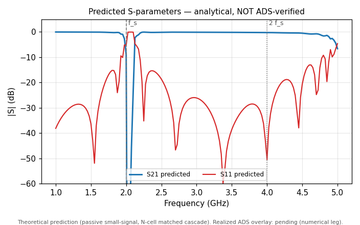
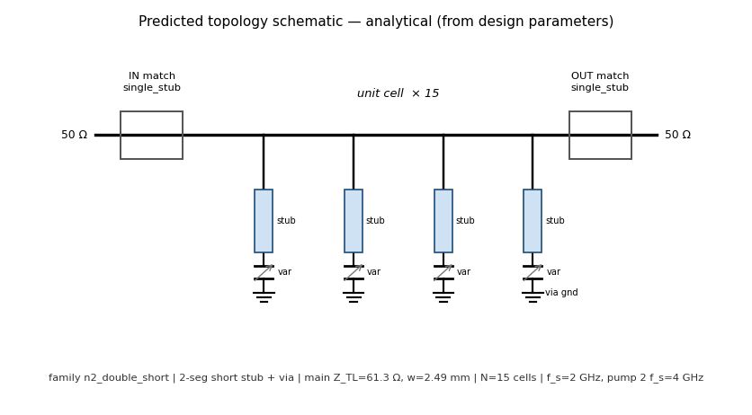
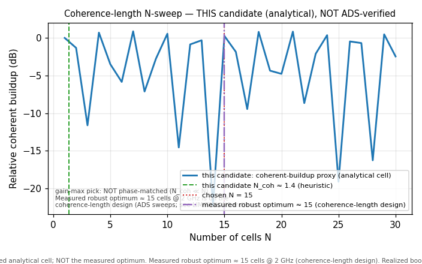

# Optimizer Run — Theoretical (Predicted) Leg

Target signal frequency (f_s): 2 GHz
Degenerate pump frequency (2 f_s): 4 GHz
Workflow: optimize-amplifier
Cells (N): 15
Screened candidates: 3247
Refined top-k: 10
Selected candidates: 3

> **PREDICTION ONLY — analytical, NOT ADS-verified.** Every number and every figure in this report is an analytical prediction from the pure-Python optimizer (`run_ads=False`).
> ANALYTICAL PREDICTION (optimistic; not ADS-verified). This is an analytical ranking, not a gain claim: the coherent-gain proxy can over-state the ADS harmonic-balance record by a family-dependent margin, and a boost ratio over a near-zero pump-off floor is never gain. Only a harmonic-balance record certified as in docs/GAIN_DEFINITIONS.md is a gain claim. See docs/LIMITATIONS.md 'Characterized Performance Limits'.
> ADS validation is optional and separate; no `.env` file is required for this pure-Python optimizer run.

## Best Candidate (predicted)

- Topology: n2_double_short
- Predicted coherent peak (analytical proxy, optimistic; see note above): 10.6 dB — PREDICTION, not ADS-verified
- Main line Z_TL: 61.3 Ω
- Main line width: 2.49 mm
- Operating varactor capacitance (G7, predicted): V_bias = 0 V, C(V_bias) = 0.3 pF
- Analytical stability margin 1−max|λ_k| (G4, proxy): -2.228 (>0 sub-threshold/stable, <0 above-threshold/oscillator; max|λ|=3.228 at -3 dBm)
- Coherence-length heuristic for THIS candidate (G5; coarse, on the simplified analytical Stage-2 cell — NOT the measured coherence-length optimum): N_coh = π/|θ(2f_s)−2θ(f_s)| = 1.394 cells (chosen N = 15; θ(f_s)=94.6°, θ(2f_s)=60.1°). This gain-max pick is NOT phase-matched (N_coh ≪ N, margin < 0); see the coherence-length note below.

## Coherence length — this candidate vs the measured optimum (G5)

The 1.39-cell figure above is **this candidate's coarse heuristic**, computed on the simplified analytical Stage-2 cell (a mid-band cell, per-cell phase ~95°). It is NOT the method's headline prediction and NOT the measured coherence-length optimum: a gain-max pick is generally not the coherence-length design and is generally not phase-matched (here N_coh ≈ 1.4 ≪ N = 15, and the analytical stability margin is < 0).

At 2 GHz the **measured robust optimum length is ~15 cells**, established by direct ADS pump/length sweeps on the coherence-length design (n3_single_short, accurate VIAGND/MLEF terminations); see [docs/LIMITATIONS.md](../../docs/LIMITATIONS.md) ("Optimal length and its mechanism"). This is consistent, at the dispersion level, with degenerate phase-matching; the exact analytical coherence length N_coh depends on the cell model and is under derivation for a follow-up. The value reported by prior band-edge analysis at this frequency, ≈15.3 cells, is not reproduced by this public optimizer's simplified mid-band cell. The reported band-edge value lives on the slow-wave BAND-EDGE realized cell (per-cell phase ~133–156°), a different and more rigorous cell than the simplified analytical cell used for the per-candidate heuristic here; the robust optimum itself is corroborated by direct measurement. See also [docs/methodology/OPTIMIZER_METHODOLOGY.md](../../docs/methodology/OPTIMIZER_METHODOLOGY.md) ("Length selection").

In short: **~15 cells is the measured robust optimum (coherence-length design); the small N_coh here is this gain-max candidate's off-phase-matching value on a coarse cell** — the two are different designs measured on different cells, not a contradiction.

## Predicted S-parameters (analytical, not ADS-verified) — G1/F2

Passive small-signal S-parameters of the N-cell Bloch-matched cascade (unpumped structure; Stage-3 input/output matching not folded in). Grid: 1–5 GHz, 161 points, Z_ref = 50 Ω.

| Frequency | S11 (dB) | S21 (dB) |
| --- | --- | --- |
| f_s = 2 GHz | -5.3 | -8.92 |
| 2 f_s = 4 GHz | -50.5 | -0.255 |

## Predicted topology schematic — F1

## Predicted coherence-length N-sweep — F3

## Geometry — electrical lengths (G2, predicted)

Physical lengths in mm with electrical length in degrees at f_s.

- Shunt stub segments (mm | electrical degrees @ f_s):
  - s1: w=2.065 mm, l=6.929 mm (26.67°)
  - s2: w=4.235 mm, l=13.88 mm (55°)
- Input match (single_stub):
  - series_line: w=3.515 mm, l=5.946 mm (23.37°), Z0=50 Ω
  - shunt_open_stub: w=3.515 mm, l=13.3 mm (52.31°), Z0=50 Ω
- Output match (single_stub):
  - series_line: w=3.515 mm, l=5.982 mm (23.52°), Z0=50 Ω
  - shunt_open_stub: w=3.515 mm, l=13.3 mm (52.3°), Z0=50 Ω

## Numerical verification (ADS): pending

This is the **theoretical (predicted) leg**. The numerical column is filled by the numerical (ADS) leg and will add, alongside each prediction above:

- ADS harmonic-balance realized gain (the realized counterpart to the optimistic coherent-gain proxy);
- realized S-parameters **overlaid on the predicted S-parameter plot above** (F2 is laid out with headroom for the overlay);
- the pump-power sweep and the realized boost-vs-N curve **overlaid on the predicted N-sweep** (F3);
- the realized stability class for the analytical margin above.

Until then, treat every figure in this report as an analytical prediction (optimistic; not ADS-verified).
